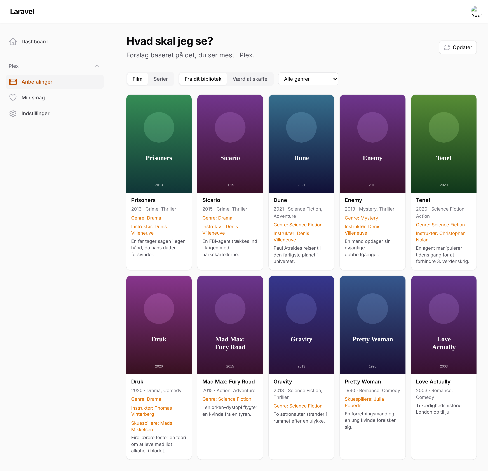
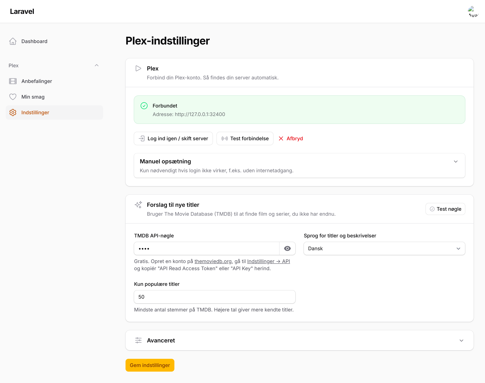
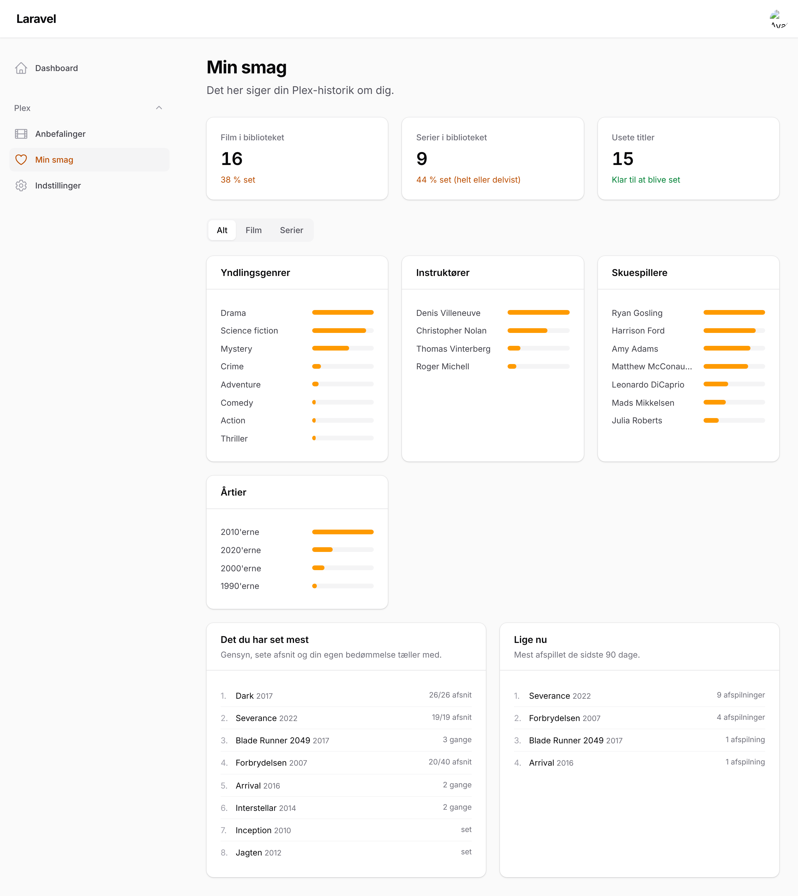

# Plex Recommender

Hvad skal du se i aften? Pakken læser, hvad du har **set mest** i Plex, og hvad du **har**
i dit bibliotek. Ud fra det foreslår den film og serier, du **ikke har set**: både fra dit
eget bibliotek og nye titler, der er værd at skaffe.

Pakken giver dig tre ting:
- **Et Filament-panel** med anbefalinger, din smagsprofil og alle indstillinger. Der er
  ingen `.env`-filer, der skal redigeres, og ingen tokens, du skal finde frem.
- **Claude Code-integration**: skriv `/anbefal serier mørk nordisk krimi` i Claude Code.
- **Artisan-kommandoer og en facade** til dine egne features.



## Installation (for udvikleren)

Kræver PHP 8.2+, Laravel 12/13 og Filament 5. Pakken er ikke på Packagist endnu, så
tilføj repoet i dit projekts `composer.json`:

```json
"repositories": [
    { "type": "vcs", "url": "https://github.com/EmilMoe/plex-test" }
]
```

```bash
composer require emilmoe/plex-recommender:dev-main   # eller dev-<branch>
php artisan plex:install
```

`plex:install` gør det hele:
- tilføjer `->plugin(PlexRecommenderPlugin::make())` til dit Filament-panel
- publicerer CSS (`filament:assets`) og config
- tilføjer MCP-serveren `plex` til `.mcp.json` og lægger `/anbefal` og `/smagsprofil` i
  `.claude/commands/`

Har du ikke et Filament-panel endnu, så kør først `php artisan filament:install --panels`.

## Brug (for alle)

Åbn panelet. Under **Plex** i menuen findes tre sider:

### 1. Indstillinger: forbind på ét minut

1. Tryk **Log ind med Plex**. Et vindue fra plex.tv åbner.
2. Log ind med din almindelige Plex-konto. Vinduet lukker af sig selv.
3. Færdig. Har du adgang til flere servere, vælger du den rigtige på en liste.

Bag om ser pakken selv, hvilke adresser serveren har, og vælger den hurtigste, der virker
(lokal før ekstern). Tokenet gemmes krypteret.

Ønsker du også forslag til titler, du *ikke* har, så indsæt en gratis TMDB-nøgle samme
sted. Der er et link og en **Test nøgle**-knap lige ved feltet. Under *Avanceret* kan du
bl.a. vælge, hvis historik der bruges, hvis I er flere på serveren.



### 2. Anbefalinger: "Hvad skal jeg se?"
- **Fra dit bibliotek**: det, du har, men ikke har set, sorteret efter hvor godt det passer
  til dig. Hver titel har en begrundelse, f.eks. *Instruktør: Denis Villeneuve*.
- **Værd at skaffe**: nye titler, der minder om dine favoritter (*Fordi du så Dark og
  Severance*).
- **Spørg Claude**: Claude læser din smagsprofil og det du har set for nylig og skriver
  personlige forslag med begrundelse. Skriv evt. hvad du er i humør til. Se
  [Spørg Claude](#spørg-claude) nedenfor.
- Skift mellem film og serier, og filtrér på genre. Klik *Hvorfor?* på et kort for at se
  præcis hvor pointene kommer fra.

### 3. Min smag
Dine yndlingsgenrer, instruktører, skuespillere og årtier, de film og serier du har set
mest (hver for sig), og hvad du har set for nylig.



## Plugin-indstillinger

```php
use EmilMoe\PlexRecommender\Filament\PlexRecommenderPlugin;

$panel->plugin(
    PlexRecommenderPlugin::make()
        ->navigationGroup('Underholdning')                   // eller null
        ->canManageSettings(fn () => auth()->user()->is_admin) // hvem må ændre indstillinger
        // ->settingsPage(false)                             // skjul siden, kun .env
);
```

## Sådan virker anbefalingerne

1. Alle film og serier hentes fra Plex med visninger, sete afsnit, din egen rating,
   genrer, instruktører og skuespillere.
2. Hver set titel får en vægt. Gensyn tæller, en serie du har set færdig tæller mere end
   en, du droppede efter to afsnit, din stjerne-rating tæller med, og nyere visninger
   vejer tungere (halveringstid 180 dage som standard). En serie vejer aldrig mere end en
   film, du har set tre gange, uanset hvor mange afsnit den har.
3. Vægtene giver en profil over genrer, instruktører, skuespillere og årtier. Usete titler
   scores mod den profil.
4. Til nye titler hentes TMDB's anbefalinger for dine mest sete titler. De rangeres efter,
   hvor mange af dine favoritter der peger på dem, genre-match og score. Titler, du
   allerede har, filtreres fra.

## Spørg Claude

Fanen *Spørg Claude* på anbefalingssiden sender din smagsprofil, din nylige historik,
listen over usete titler i dit bibliotek og det du allerede har set til Claude. Svaret
tjekkes mod dit bibliotek: titler du har set, fjernes, og titler du har, markeres.
Svaret gemmes i 12 timer. Tryk *Spørg igen* for nye forslag.

Vælg under **Indstillinger → Spørg Claude**:

- **Claude Code på denne computer** (standard): kører `claude -p` med dit eget Claude-login.
  Ingen API-nøgle, men appen skal køre på samme computer som Claude Code, og forbruget
  tæller med i dit abonnement. Webserveren skal kunne finde `claude`. Finder den ikke
  programmet, så indsæt stien fra `which claude`. Claude Code skal være logget ind som
  den bruger, webserveren kører som. Tryk *Test forbindelse* for at tjekke.
- **Claude API**: til når appen kører på en server. Kræver en API-nøgle fra
  console.anthropic.com (betales efter forbrug) og `composer require anthropic-ai/sdk`.
- **Slået fra**.

Fra terminalen: `php artisan plex claude show --wish="noget let og dansk"`.

## Claude Code (MCP)

Efter `plex:install` kender Claude Code MCP-serveren `plex` (`php artisan mcp:start plex`).
Godkend den første gang (eller tjek med `/mcp`).

| Kommando | |
|---|---|
| `/anbefal` | Anbefalinger af både film og serier |
| `/anbefal serier mørk nordisk krimi` | Med type og stemning |
| `/smagsprofil` | Analyse af din seersmag |

Du kan også spørge frit: *"Har jeg set Severance, Dark og The Bear?"* Claude tjekker sine
egne forslag mod dit bibliotek med `check-owned`.

MCP-værktøjer: `library-overview`, `taste-profile`, `most-watched`, `recent-history`,
`unwatched-in-library`, `recommend-new`, `check-owned`, `search-library`, `refresh-cache`.

## Artisan

```bash
php artisan plex:login                     # log ind uden browser (viser et link)
php artisan plex:logout
php artisan plex overview
php artisan plex profile [movie|show]
php artisan plex most-watched show --days=90
php artisan plex unwatched movie --genre=Thriller
php artisan plex recommend show
php artisan plex claude movie --wish="noget let" [--fresh]
php artisan plex check "Dark (2017)" "The Bear"
```
Tilføj `--json` for rå JSON.

## I din egen kode

```php
use EmilMoe\PlexRecommender\Facades\PlexRecommender;

PlexRecommender::unwatchedInLibrary('movie', 10);
PlexRecommender::recommendNew('show', 10);
PlexRecommender::tasteProfile();
PlexRecommender::checkOwned(['Dune (2021)']);
```

## Indstillinger fra .env (valgfrit)

Alt kan sættes i panelet. Værdier i `.env` bruges kun som standard, indtil der er gemt
noget i panelet:

| Variabel | Felt i panelet |
|---|---|
| `PLEX_URL`, `PLEX_TOKEN` | Plex → Manuel opsætning |
| `TMDB_API_KEY` | TMDB API-nøgle |
| `PLEX_RECOMMENDER_LANGUAGE` | Sprog |
| `PLEX_ACCOUNT_ID` | Avanceret → Hvis historik |
| `PLEX_VERIFY_SSL` | Avanceret → Kontrollér certifikat |
| `PLEX_RECOMMENDER_CACHE_TTL` | Avanceret → Opdater biblioteket hvert … |
| `PLEX_RECOMMENDER_CLAUDE` (`code`/`api`/`off`) | Spørg Claude → Hvordan |
| `PLEX_RECOMMENDER_CLAUDE_BINARY` | Spørg Claude → Sti til Claude Code |
| `PLEX_RECOMMENDER_CLAUDE_MODEL` | Spørg Claude → Model |
| `ANTHROPIC_API_KEY` | Spørg Claude → API-nøgle |

Indstillingerne gemmes krypteret med `APP_KEY` i `storage/app/plex-recommender.json`.

## Tests

```bash
composer install && vendor/bin/phpunit
```
Testene kører med `Http::fake()` og Livewire-tests af Filament-siderne. De kræver
hverken Plex eller TMDB.
